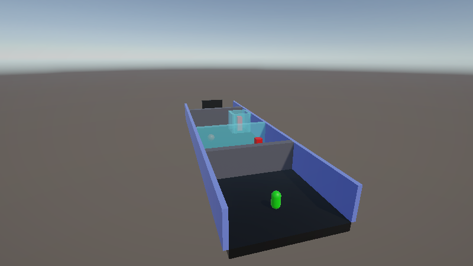
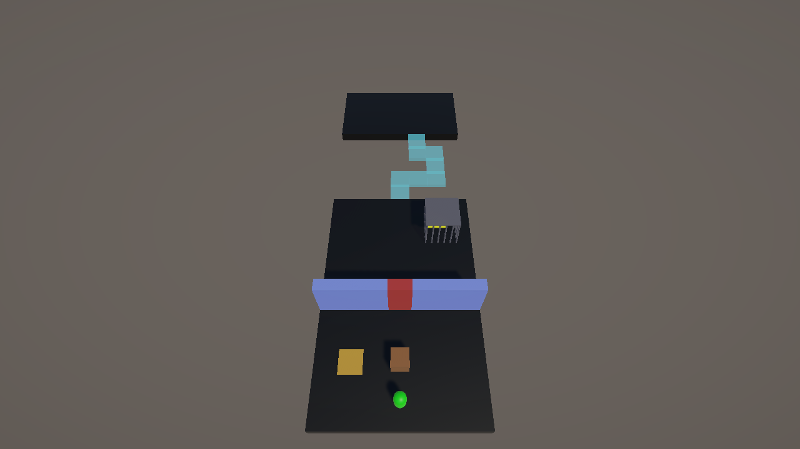
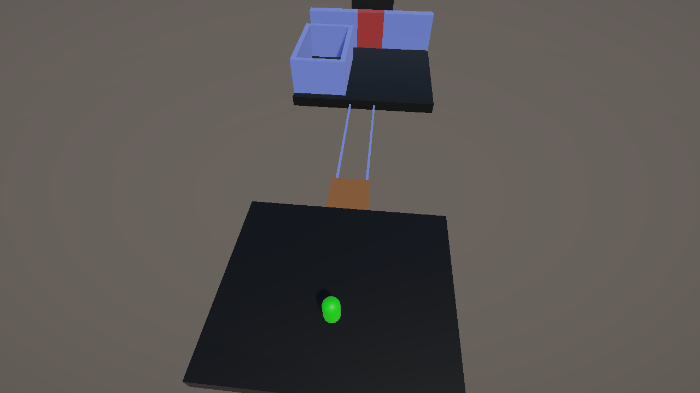
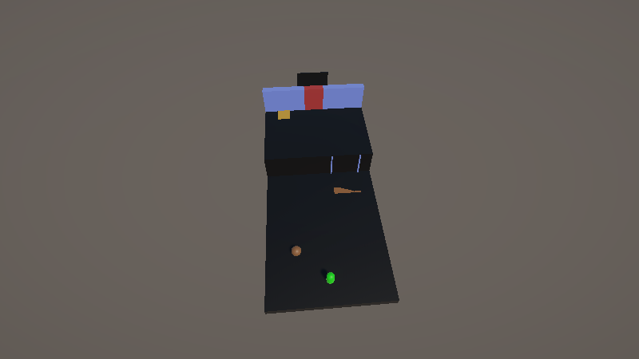
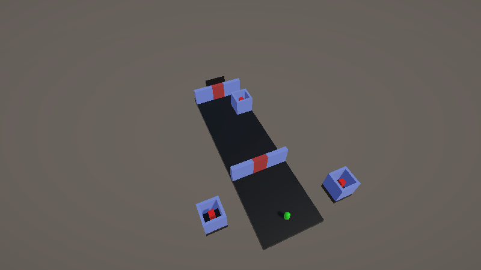
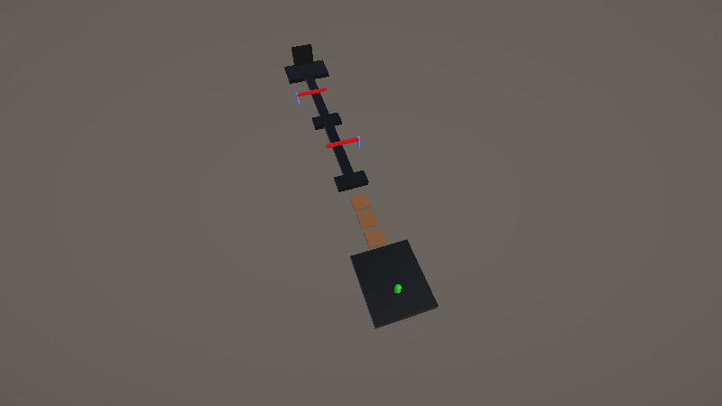
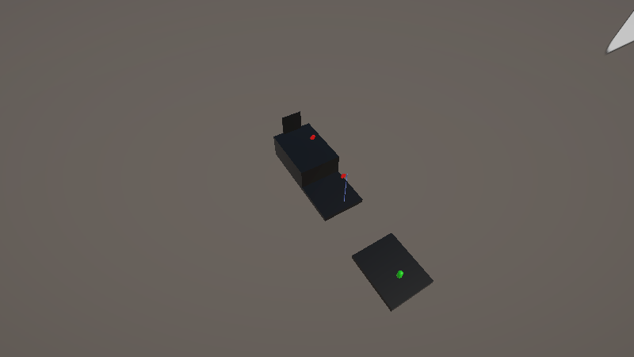
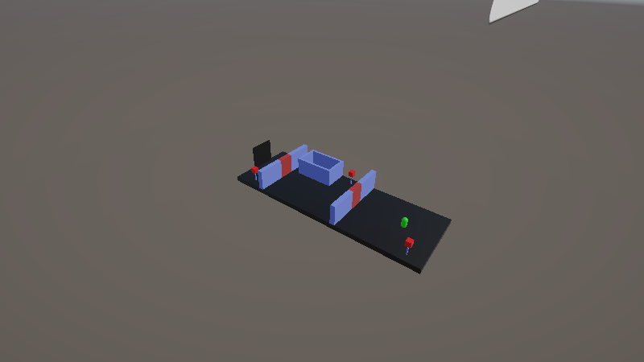

# Soul Escape

> 몸과 혼을 번갈아 조종해 방을 빠져나가는 3D 퍼즐 게임

이전에 만들었던 게임 **Soul Escape**를 **Unity CLI MCP**와 **Claude**로 다시 손보고 있는 프로젝트입니다. 원본의 몸·혼 전환 규칙은 그대로 두고, 버그를 고치고 새 기믹과 스테이지를 더해 가고 있습니다.



## 게임 컨셉

플레이어는 **몸**과 몸에서 빠져나온 **혼**을 번갈아 조종합니다. 둘은 할 수 있는 일이 서로 달라서, 한쪽이 길을 열면 다른 쪽이 지나가는 식으로 퍼즐을 풉니다.

| | 몸 | 혼 |
|---|---|---|
| 벽 | 막힘 | 통과 |
| 무게 (발판, 상자) | 있음 | 없음 |
| 열쇠 줍기 | 가능 | 불가 |
| 스위치 | 몸 스위치 | 혼 스위치 |

- 혼을 꺼내면 몸은 그 자리에 멈춰 무방비 상태가 됩니다.
- 열쇠를 몸으로 주우면 탈출구가 나타나고, 탈출구에 들어가면 다음 스테이지로 넘어갑니다.
- 낭떠러지에 떨어지면 스테이지가 처음부터 다시 시작됩니다.

## 조작

| 키 | 동작 |
|---|---|
| `W` `A` `S` `D` / 방향키 | 이동 (몸·혼 공통) |
| `Space` | 점프 (몸) |
| `F` | 혼 꺼내기 / 어디서든 몸으로 복귀 |
| `E` | 물건에 빙의·해제, 고리에 혼의 끈 걸기·끊기 |
| `W` / `S` (빙의·끈 상태) | 승강기 오르내리기, 끈 감기·풀기 |
| `R` | 혼의 움직임 녹화 시작·정지 |

## 스테이지

| 스테이지 | 핵심 기믹 |
|---|---|
| Stage1, Stage2 | 원본 스테이지. 몸 스위치, 혼 스위치, 열쇠와 탈출구 |
| Stage3 | 무게 발판과 미는 상자, 혼만 통과하는 철창, 혼이 지나간 칸만 켜지는 혼 전용 다리 |
| Stage4 | 누르고 있는 동안만 켜지는 혼 스위치, 한 번 넣으면 못 빼는 상자 구멍 (되돌릴 수 없는 선택) |
| Stage5 | 혼 빙의, 혼이 빠지면 쓰러지는 몸 |
| Stage6 | 승강기 빙의, 여러 물건에 갈아타며 빙의 |
| Stage7 | 몸·혼 통과 규칙을 뒤바꾸는 전환 기둥 |
| Stage8 | 시간제한 기둥과 문, 복귀 시간까지 계산하는 퍼즐 |
| Stage9 | 챕터 능력 1: 혼의 정지 |
| Stage10 | 챕터 능력 2: 혼의 끈 |
| Stage11 | 챕터 능력 3: 혼의 녹화와 잔상 |
| ButtonStage | 모든 바닥 버튼을 한 번씩만 밟아 켜기 (같은 칸을 두 번 밟으면 재시작) |
| FinalStage | 마지막 스테이지 |

진행 순서는 `Stage2 → Stage3 → … → Stage11 → ButtonStage`입니다.

### Stage3: 상자, 철창, 혼 전용 다리



- 몸이 상자를 노란 **무게 발판**에 밀어 올리면 문이 열린 채 유지됩니다. 혼은 무게가 없어 발판을 못 누릅니다.
- 열쇠는 몸만 막는 **철창** 안에 있습니다. 혼이 들어가 안쪽 스위치를 건드리면 철창이 내려갑니다.
- 낭떠러지에 숨은 **혼 전용 다리**는 혼이 지나간 칸만 켜지고, 혼이 돌아온 뒤 12초 동안 몸이 밟을 수 있습니다.

### Stage5: 혼 빙의



- 혼 상태에서 물건에 다가가면 하늘색으로 빛나고, `E`로 들어가 그 물건을 직접 굴리거나 움직입니다.
- 혼은 무게가 없지만 **빙의한 물건은 무게가 있어서** 발판을 누를 수 있습니다.
- 혼이 빠져나간 몸은 털썩 쓰러져 **물리 오브젝트**가 됩니다. 수레에 빙의해서 쓰러진 몸을 싣고 낭떠러지를 건너고, 공에 빙의해 혼만 들어가는 우리 안의 발판을 누릅니다.

### Stage6: 승강기와 갈아타기



- 혼이 빙의하면 `W`/`S`로 오르내리는 **승강기**가 추가됐습니다.
- 몸을 승강기에 눕히고, 공에 빙의해 승강기로 굴려 오고, 승강기로 갈아타 둘을 함께 올린 뒤, 다시 공으로 갈아타 위층 발판을 누릅니다.
- 혼이 지형 높이를 따라 떠다녀서 높은 곳의 물건에도 닿습니다 (`Follow Ground` 옵션).

### Stage7: 통과 규칙 전환


- **회색 돌벽**은 몸과 물건을 막고 혼은 통과시킵니다.
- **하늘색 막**은 혼을 막고 몸과 물건은 통과시킵니다.
- **노란 전환 기둥**에 몸·혼·빙의한 물건 중 무엇이든 닿으면 스테이지의 모든 벽이 돌벽과 막으로 한꺼번에 뒤바뀝니다. 혼이 못 들어가는 막 안의 기둥은 공에 빙의해 굴려 들어가 건드립니다.

### Stage8: 시간제한



- **시간제한 기둥**은 혼이 닿으면 몇 초 동안 켜지고, 남은 시간만큼 바닥으로 줄어듭니다.
- **시간제한 문**은 연결된 기둥이 모두 켜져 있는 동안만 열립니다.
- 혼이 `F`로 몸까지 날아가는 시간도 제한 시간에 포함됩니다. 몸을 어디에 세워 두고 기둥을 어떤 순서로 누를지가 퍼즐입니다.

### Stage9: 혼의 정지



- 혼이 닿으면 움직이는 물체가 하늘색으로 변하며 몇 초간 멈춥니다.
- 빠르게 오르내리는 발판은 꼭대기에서 멈춰야 다리가 되고, 빙글빙글 도는 막대는 다리 밖을 가리킬 때 멈춰야 지나갈 수 있습니다. 멈추지 않고는 건널 수 없도록 속도를 맞췄습니다.

### Stage10: 혼의 끈



- 혼이 높이 떠 있는 고리에 `E`로 걸면 쓰러진 몸과 고리 사이에 줄이 생깁니다.
- `W`로 감고 `S`로 풀며, 몸은 끌려가거나 허공에서 그네처럼 흔들립니다. `E`로 끊으면 그 자리에 떨어집니다.
- 점프로는 못 건너는 10칸 낭떠러지와 5칸 높이 벽을 줄로 넘습니다.

### Stage11: 혼의 녹화



- 혼 상태에서 `R`로 녹화를 시작·정지합니다 (최대 10초).
- 녹화가 끝나면 **보라색 잔상**이 같은 경로를 따라간 뒤 마지막 자리에 머뭅니다. 잔상도 혼 스위치를 누릅니다.
- 멀리 떨어진 혼 스위치 두 개를 동시에 누르거나, 잔상에게 스위치를 맡기고 공에 빙의해 발판을 누른 뒤 몸으로 돌아가 문을 지나갑니다.

## 개선 작업

### 버그 수정과 정리

- **스크립트 이름 정리**: 모든 스크립트에서 `Chanthink_` 접두사를 뺐습니다 (예: `Chanthink_PlayerController` → `PlayerController`). `.meta` GUID는 유지해 씬 참조가 깨지지 않습니다.
- **UI 버튼**: Stage1, Stage2, ButtonStage에 EventSystem이 없어 Retry·Main·Quit 버튼이 눌리지 않던 문제를 고쳤습니다.
- **점프**: 바닥 두 개에 걸쳐 서 있거나 벽을 스칠 때 점프가 막히던 문제를, 점프 순간 발밑을 직접 검사하도록 바꿔 고쳤습니다. ButtonStage의 바닥 버튼도 Ground 레이어로 바꿔 그 위에서 점프할 수 있습니다.
- **혼 복귀**: 몸에서 3칸 안에 있어야 돌아오던 제한을 없앴습니다. 어디서든 `F`를 누르면 혼이 몸까지 천천히 날아가 스며들고, 카메라도 혼을 따라 부드럽게 몸으로 돌아옵니다. 혼의 이동 거리 제한도 없앴습니다.
- **쓰러진 몸 착지**: 혼이 빠질 때 쓰러지고 복귀할 때 일어나는 몸이 벽·수레·상자와 겹치거나 바닥 아래로 빠지던 버그를 고쳤습니다. 쓰러질 때는 빈 자리와 발밑 바닥이 있는 방향을 먼저 찾고, 일어날 때는 설 공간이 없으면 주변의 같은 높이 빈자리를 찾아 세웁니다.
- **발판과 스위치**: 공이 발판 위에서 멈춰 잠들면 발판이 풀리던 문제, 혼과 잔상이 같은 혼 스위치에 있다가 한쪽이 떠나면 꺼지던 문제를 고쳤습니다.

### 참고한 게임

- **Human: Fall Flat**: 물리 오브젝트를 직접 다루는 퍼즐 → 혼 빙의, 물건이 되는 몸 (Stage5, Stage6)
- **It Takes Two**: 챕터마다 서로 맞물리는 능력 한 쌍 → 혼의 정지, 혼의 끈, 혼의 녹화 (Stage9 ~ Stage11)

### 작업 방식

Unity 에디터를 **Unity CLI**와 MCP 서버로 Claude에 연결해서, Claude가 스크립트 작성, 씬 배치, 플레이 모드 테스트까지 에디터 안에서 직접 진행합니다. 사람은 방향을 정하고 직접 플레이해 손맛을 확인합니다.

## 실행 방법

1. **Unity 6000.3.24f1**로 이 폴더를 엽니다.
2. `Assets/Scenes/Main.unity`를 열고 Play를 누릅니다.

## 폴더 구조

```
Assets/
  Scenes/     스테이지 씬 (Main, Stage1 ~ Stage11, ButtonStage, FinalStage)
  Scripts/    게임 스크립트 (몸·혼 조작, 스위치, 발판, 빙의 등)
  Prefebs/    벽, 바닥, 스위치, 상자, 발판 등 프리팹
  Material/   머티리얼
docs/images/  README용 스테이지 스크린샷
```
